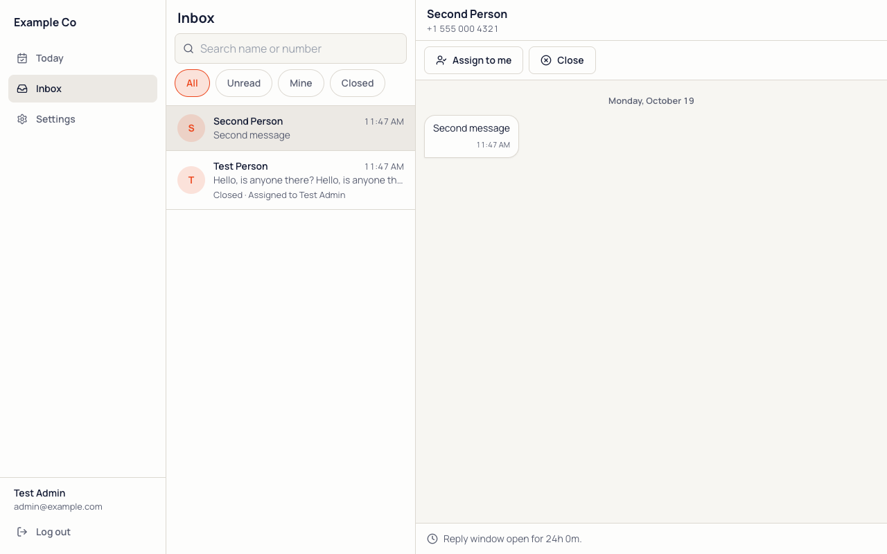
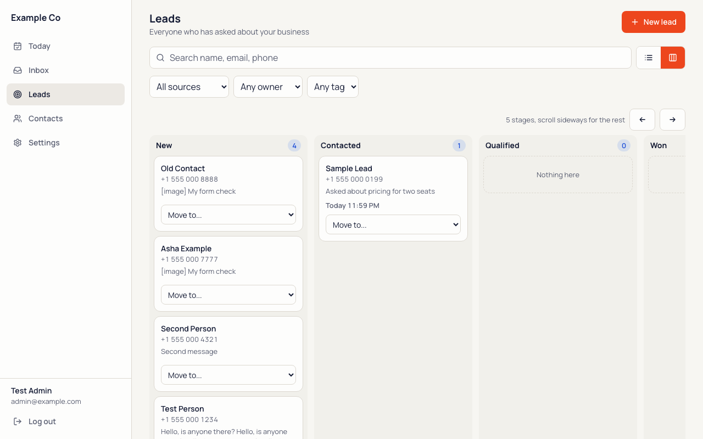
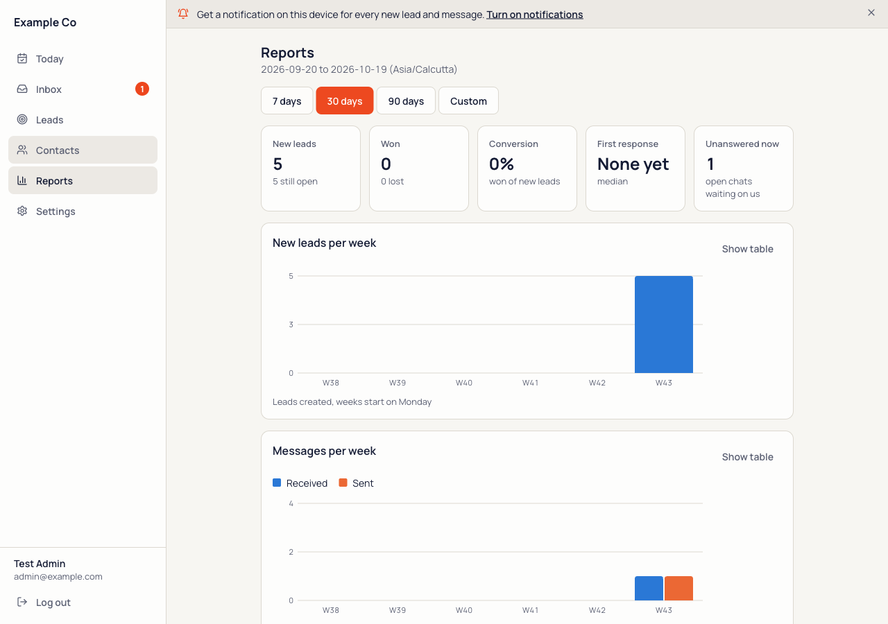
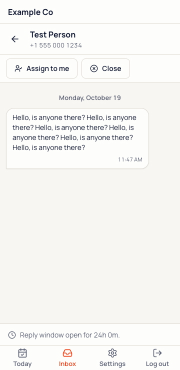

# WhaLeads

A free WhatsApp lead inbox, CRM and automation builder for a small team that takes enquiries on one WhatsApp number.

- A shared inbox with the 24 hour reply window shown on every chat, and leads with stages, tags, owners, notes and reports.
- Click-to-WhatsApp ads are attributed: the ad's id, headline and link are saved on the lead.
- Message templates (including image, video and document headers, and one-time-code templates sent by API) and no-code automations with a dry run and a shadow mode.
- Basic broadcasts: send one approved template to leads picked by tag, paced by the Worker, with opt-outs honoured (STOP keywords, Meta's opt-out signal, or by hand).
- Web push notifications on any phone once the app is installed.
- One WhatsApp number per deployment, by design. Deploy again for another number.
- Built to run on the Cloudflare Workers Free plan: one Worker, one D1 database, one Durable Object for the live inbox, an optional R2 bucket for media.
- Your data stays in your Cloudflare account. No telemetry, no phone-home. Apache-2.0.
- Connect your WhatsApp number through WhaBuzz in one click (Settings, WhatsApp, "Connect with WhaBuzz"), or bring your own Meta Cloud API app.
- One number, one team, self-hosted: WhaLeads. Many numbers or many clients: use WhaBuzz directly.

| Leads board | Reports | On a phone |
|---|---|---|
|  |  |  |

The screenshots use made-up example data.

## First run

1. **Deploy.** Press the button, paste a `SESSION_SECRET` (32+ random characters, `openssl rand -hex 32`) and keep a copy.
2. **Open** the `workers.dev` address the deploy ends on.
3. **Set up.** `/setup` asks for that secret once, then creates the first admin and locks itself.
4. **Connect WhatsApp.** Settings, WhatsApp: press "Connect with WhaBuzz", sign in, pick the number, and you are back with keys in place. Or enter the keys of your own Meta Cloud API app. The flow, its routes and the `WHABUZZ_BASE_URL` / `WHABUZZ_CONNECT_BASE` variables are in [ADAPTORS](docs/ADAPTORS.md).
5. **Add staff.** Settings, Team.

**Locked out?** Open `/recover` ("Forgot your password?" on the login page) and use your setup key, the `SESSION_SECRET` you kept from step 1. Team members ask an admin to reset theirs from Settings, Team.

Prefer the command line? [docs/DEPLOY.md](docs/DEPLOY.md) has `wrangler deploy` and the custom-domain step.

## Documentation

- [Deploy](docs/DEPLOY.md): the button, the CLI path, custom domain, environment reference
- [Adaptors](docs/ADAPTORS.md): connect with WhaBuzz or the Meta Cloud API
- [Automations](docs/AUTOMATIONS.md): triggers, nodes, shadow mode, dry run
- [Runbook](docs/RUNBOOK.md): how each part behaves (auth, inbox, templates, CRM, push, data)
- [API](docs/API.md): routes, auth and the website form payload
- [Routes](docs/ROUTES.md): every route with its auth, CSRF and rate-limit rule
- [Security model](docs/SECURITY-MODEL.md): what is protected, what you are responsible for
- [Contributing](CONTRIBUTING.md), [Security](SECURITY.md), [Code of Conduct](CODE_OF_CONDUCT.md)

## Where WhaLeads stops

Several numbers in one deployment, multi-client hosting and voice are out of scope. Need many numbers or many clients? Use WhaBuzz directly.

## License

[Apache-2.0](LICENSE). Copyright 2026 WhaBuzz.
